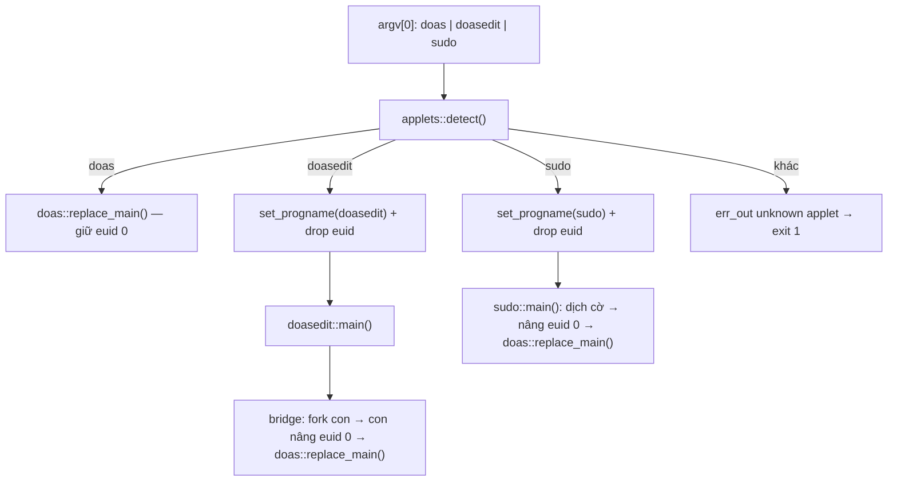
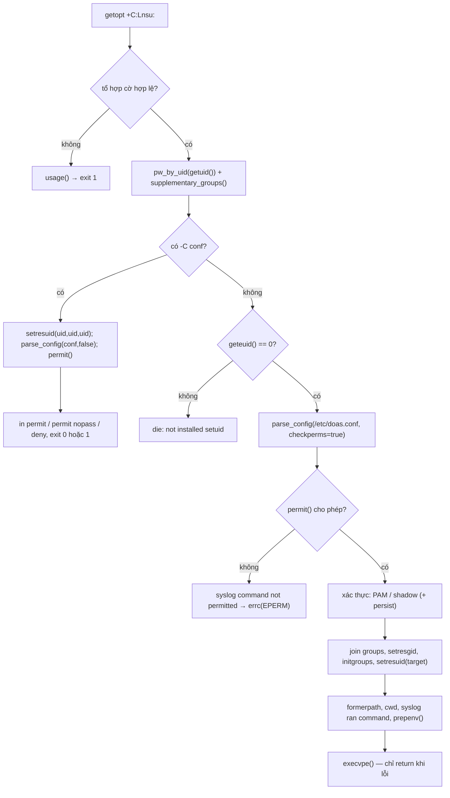
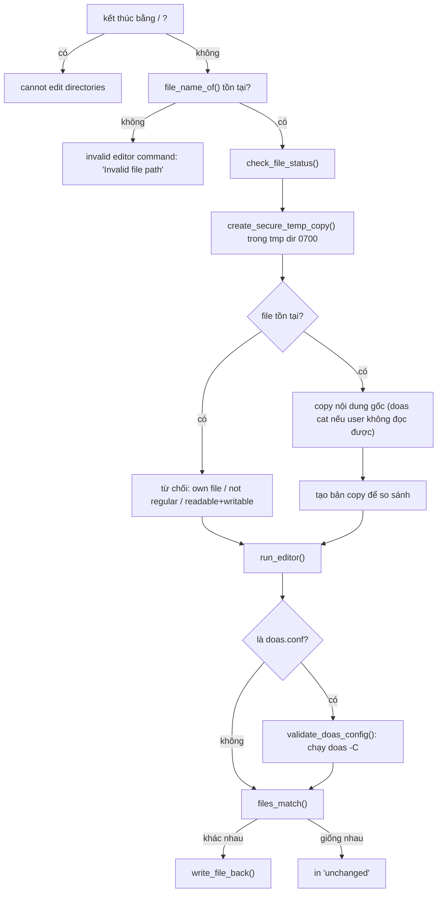
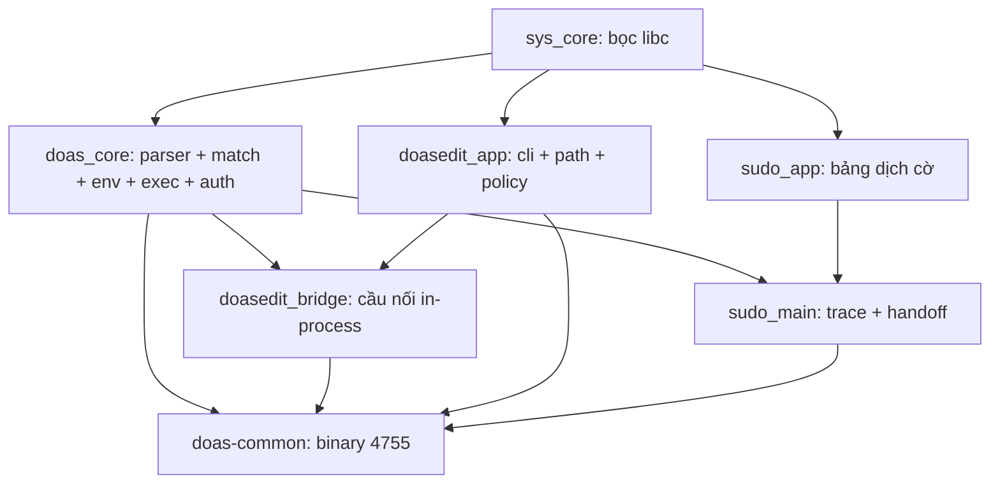

# Kiến trúc `doas-common`

Bản C++23 của ba chương trình:

| Bản gốc                                                                                    | Ngôn ngữ | Thành phần        |
| ------------------------------------------------------------------------------------------ | -------- | ----------------- |
| OpenDoas (`doas.c`, `env.c`, `pam.c`, `shadow.c`, `timestamp.c`, `parse.y`, `libopenbsd/`) | C        | applet `doas`     |
| `doasedit` (`src/*.rs`)                                                                    | Rust     | applet `doasedit` |
| `fudo` (`fudo.c`)                                                                          | C        | applet `sudo`     |

Mục tiêu tương thích: cùng một đầu vào phải cho cùng stdout, stderr, exit code và
cùng quyết định `permit`/`deny` như bản gốc. Các bảng trong tài liệu này đối
chiếu từng đơn vị mã của bản C/Rust với mã tương ứng ở đây.

---

## 1. Cấu trúc mã

```
src/
├── sys/            lớp bọc libc dùng chung (thay libopenbsd)
│   ├── error.{hpp,cpp}      Error, Err, Result<T>, Status, die()/warn()
│   ├── fs.{hpp,cpp}         Fd (RAII), stat/open/read/write/copy/mkdtemp/…
│   ├── io.{hpp,cpp}         out/err_out/flush_all, FileHandle (RAII cho FILE*)
│   ├── numbers.{hpp,cpp}    parse_int (strtonum), parse_u64 (strtoull)
│   ├── process.{hpp,cpp}    fork/wait/exec/signal/env/uid-gid/closefrom/which
│   ├── secret.{hpp,cpp}     buffer bí mật tự wipe bằng explicit_bzero
│   ├── strings.{hpp,cpp}    BoundedString (strlcpy/strlcat), utf8_valid
│   ├── terminal.{hpp,cpp}   isatty, ttyname, readpassphrase
│   ├── time.hpp             ts_set/ts_lt/ts_gt/ts_add (constexpr)
│   └── users.{hpp,cpp}      passwd/group/shadow lookup, crypt, getgroups
├── doas/           applet doas
│   ├── doas.cpp             main, check_config, vòng đời tiến trình
│   ├── config.{hpp,cpp}     Rule, match_rule/permit, parse_uid/parse_gid, parse_config
│   ├── parse.y              grammar bison (C++ skeleton) cho doas.conf
│   ├── env.cpp              create_env/fill_env/prepenv (dựng envp)
│   ├── exec.{hpp,cpp}       execvpe (port libopenbsd/execvpe.c)
│   ├── auth.{hpp,cpp}       password_prompt, dispatch PAM/SHADOW
│   ├── pam.cpp              pamauth, pam_conv, watch_session
│   ├── shadow.cpp           shadow_auth (crypt(3) + /etc/shadow)
│   └── timestamp.{hpp,cpp}  timestamp_open/set/clear (khi DOAS_PERSIST)
├── doasedit/       applet doasedit
│   ├── cli.{hpp,cpp}        parse CLI tương thích clap, help/version text
│   ├── path.{hpp,cpp}       is_directory_path, parent_of, file_name_of
│   ├── doasedit.cpp         check_file_status, process_file, prose(), main
│   └── bridge.{hpp,cpp}     cầu nối gọi doas in-process (fork + pipe)
├── sudo/           applet sudo
│   ├── sudo.{hpp,cpp}       bảng kEquiv + translate() thuần
│   └── main.cpp             trace, export SUDO_*, handoff sang doas
└── applets/
    ├── dispatch.hpp         enum Applet
    └── main.cpp             detect(argv[0]), drop quyền, điều phối
```

Khoảng 8.100 dòng C++/Yacc cho `src/` + `tests/`. Phụ thuộc ngoài: libc, libpam
(hoặc libcrypt), Bison lúc build.

---

## 2. Kiến trúc multicall

### 2.1 Nhận diện applet

`applets::detect()` lấy basename của `argv[0]` (cắt tại `/` cuối cùng) rồi so với
`doas` / `doasedit` / `sudo`. Không khớp thì in
`doas-common: unknown applet; invoke as one of: doas, doasedit, sudo` và trả 1.
Tên applet phụ thuộc tên file được gọi, nên ba symlink là đủ và `doas-common` gọi
trực tiếp không chạy applet nào. Bản gốc là ba binary riêng, mỗi binary tự xác
định danh tính từ `argv[0]` (fudo) hoặc không cần (doas, doasedit).

### 2.2 Quyền của tiến trình

Binary cài mode `4755`. Ở entry point:

- applet `doas`: giữ nguyên euid 0 do setuid mang lại;
- applet `doasedit` / `sudo`: gọi `drop_effective_privileges()` →
  `setresuid(uid, uid, 0)`, euid trở về user thật nhưng **saved uid vẫn là 0**.

Việc giữ saved uid 0 thay cho `exec` sang `/usr/bin/doas` của bản gốc: bản gốc
`doasedit`/`sudo` là binary thường rồi `exec` sang `doas` (có setuid) để lấy quyền
root; ở đây quyền root được giữ trong saved uid và nâng lại bằng
`setresuid(kKeepId, 0, kKeepId)` trước khi vào applet doas.

### 2.3 Handoff in-process



- `sudo`: in trace, export `SUDO_*`, rồi `set_res_uid(kKeepId, 0, kKeepId)` và gọi
  `doas::replace_main()` với argv đã dịch. Khi binary không setuid, lần nâng quyền
  thất bại và applet doas báo `not installed setuid` — cùng thông điệp mà bản gốc
  phát ra khi gọi `doas` thiếu setuid.
- `doasedit`: các bước cần quyền root (`doas cat`, `doas stat`, `doas dd`) đi qua
  `bridge::spawn_capture()` / `spawn_discard()`: `fork()`, tiến trình con nâng euid
  về 0 rồi gọi `doas::replace_main()`; stdout của con nối vào pipe cho cha đọc,
  stderr và stdin về `/dev/null`. Mô hình "gọi doas như subprocess" của bản Rust
  (`Command::new("doas")`) được giữ nguyên về mặt quan sát, nhưng không phụ thuộc
  việc có binary `doas` trong `PATH`. Con `_exit()` chứ không `exit()` để đệm stdio
  không bị flush hai lần.

---

## 3. Tầng nền `sys/`

`libopenbsd/` được thay bằng các lớp bọc C++:

| libopenbsd / libc                                 | Tương ứng ở đây                                             | Ngữ nghĩa giữ nguyên                                                                                  |
| ------------------------------------------------- | ----------------------------------------------------------- | ----------------------------------------------------------------------------------------------------- |
| `strlcpy`/`strlcat`                               | `sys::BoundedString`                                        | cắt chuỗi tại `cap - 1`, đếm độ dài như bản gốc; dùng cho dòng log `LINE_MAX` và đường dẫn `PATH_MAX` |
| `strtonum`                                        | `sys::parse_int`                                            | khoảng giá trị, tràn, `minval > maxval`, chấp nhận khoảng trắng đầu và dấu `+`/`-`                    |
| `strtoull` + kiểm tra thủ công                    | `sys::parse_u64`                                            | chỉ từ chối khi không có chữ số hoặc tràn                                                             |
| `readpassphrase`                                  | `sys::readpassphrase`                                       | cùng cờ `RPP_*`, cùng cách xử lý tty và EOF                                                           |
| `closefrom`                                       | `sys::process::close_from`                                  | glibc ≥ 2.34                                                                                          |
| `setprogname`/`getprogname`                       | `sys::set_progname`                                         | cập nhật cả `program_invocation_(short_)name` để getopt(3) của libc dùng cùng tiền tố                 |
| `execvpe` (OpenBSD)                               | `doas::execvpe`                                             | cùng quy tắc duyệt `PATH`, cùng phân loại errno, cùng fallback `/bin/sh`                              |
| `sys-tree.h` (RB tree)                            | `std::map`                                                  | thứ tự từ điển, nên `envp` sinh ra trùng khớp từng dòng                                               |
| `sys-time.h` (`tset/tslt/tsgt/tsadd`)             | `sys::ts_set/ts_lt/ts_gt/ts_add`                            | số học trên `timespec`, không chuẩn hoá khi so sánh                                                   |
| `explicit_bzero` gọi thủ công                     | `sys::Secret`                                               | wipe trong destructor, cộng wipe tường minh trên đường `die()` (destructor không chạy khi `exit`)     |
| `bsd-setres_id.c`                                 | `sys::process::set_res_uid`, `set_res_gid`, `init_groups`   | cùng cách gọi `setresuid`/`setresgid`/`initgroups`                                                    |
| `errc.c`, `verrc.c`                               | `sys::die`, `sys::warn`                                     | một điểm vào duy nhất cho mọi chẩn đoán                                                               |
| `reallocarray.c`                                  | `std::vector`                                               | cấp phát có kiểm tra overflow do thư viện chuẩn lo                                                    |
| `getpwnam`/`getpwuid_r`/`getgrnam_r`/`getspnam_r` | `sys::pw_by_uid`, `pw_by_name`, `gr_by_name`, `shadow_hash` | vòng lặp `ERANGE`, copy chuỗi ra khỏi static storage của libc                                         |
| `crypt(3)`                                        | `sys::crypt_hash`                                           | trả bản copy của hash; buffer tĩnh của libc không thoát ra ngoài                                      |

### 3.1 Mô hình lỗi

Hai kiểu dữ liệu cho mọi thao tác có thể thất bại:

```cpp
struct Error {
    std::error_code code;
    std::string subject;   // ngữ cảnh, thường là đường dẫn
    bool is(Err value) const;      // điều kiện mức ứng dụng
    bool from_errno() const;       // code thuộc generic_category
    int errno_value() const;
};
template <class T> using Result = std::expected<T, Error>;
using Status = std::expected<void, Error>;
```

- `Err` (mức ứng dụng, category tên `"doas"`): `kNotFound`, `kNotATerminal`,
  `kInvalidNumber`, `kTooSmall`, `kTooLarge`. Lỗi syscall giữ
  `std::generic_category()`, nên `code.message()` đúng bằng `strerror(3)` và
  `die()` in ra byte-identical với `err(3)`/`errc(3)` của bản C.
- Vắng mặt **không phải** lỗi trả `std::optional<T>`: `process::get_env`,
  `terminal::tty_name`, `process::which`, `fs::current_dir`.
- Vị từ thuần trả `bool`: `strings::utf8_valid`, `BoundedString::append` (cờ cắt
  chuỗi).
- Biên giữ hình dạng C: exit code tiến trình, `argv`/`environ`, mảng `char*` cho
  `execve`, cờ `RPP_*` và buffer của `readpassphrase`, `sigaction`/`sigset_t`, con
  trỏ hàm handler, `getopt`.
- API trả `Result`/`Status`/`optional` đều `[[nodiscard]]`; bỏ kết quả phải viết
  `(void)` tại chỗ.
- So sánh: `err.is(Err::kNotFound)` cho lỗi ứng dụng,
  `err.code == std::errc::no_such_file_or_directory` cho errno.

### 3.2 Vòng đời tài nguyên

| Lớp               | File         | Vai trò                                                                        |
| ----------------- | ------------ | ------------------------------------------------------------------------------ |
| `sys::fs::Fd`     | `fs.hpp`     | chủ sở hữu duy nhất của fd, move-only, `get()` chỉ cho mượn                    |
| `sys::FileHandle` | `io.hpp`     | chủ sở hữu `FILE*` (lexer của parser đọc bằng `getc`/`ungetc`)                 |
| `sys::Secret`     | `secret.hpp` | buffer mật khẩu, `explicit_bzero` trong destructor                             |
| `PamSession`      | `pam.cpp`    | chủ sở hữu `pam_handle_t*`, giải phóng qua `pam_end`                           |
| `RespPtr`         | `pam.cpp`    | `std::unique_ptr` với `free` của libc (libpam nhận quyền sở hữu chuỗi trả lời) |

Không có `new`/`delete` trong cây; cấp phát động chỉ ở vector/string/unique_ptr và
fd mở file.

---

## 4. Applet `doas`

### 4.1 Luồng chính (`doas.cpp`, port của `doas.c main()`)



Các điểm hành vi của bản C được giữ nguyên:

- `-L` thoát ngay trong vòng `getopt`; khi có timestamp thì exit status phản ánh
  kết quả của `timestamp_clear`, ngược lại là 0.
- `-C` không kiểm quyền file cấu hình, tự `setresuid(uid, uid, uid)` để mất đặc
  quyền, rồi in `permit`, `permit nopass` hoặc `deny` ra stdout.
- Không có `-C` thì `/etc/doas.conf` phải thuộc root và không writable bởi
  group/other.
- Ghi syslog `"%s ran command %s as %s from %s"` trừ khi rule có `nolog`.
- `closefrom(STDERR_FILENO + 1)` trước khi xử lý tiếp.

### 4.2 Parser `doas.conf` (`parse.y`)

Bison với skeleton C++ (`%language "C++"`, `%skeleton "lalr1.cc"`), namespace
`doas`, class `doas::ConfigParser`, `api.value.type variant` và token constructor.
Lexer viết tay bằng `getc`/`ungetc` trên `FILE*` như bản gốc, nên cùng một file lỗi
cho cùng số dòng trong thông điệp.

Rule sau khi parse:

```cpp
struct Rule {
    int action;                                 // kPermit | kDeny
    unsigned options;                           // kNopass|kKeepenv|kPersist|kNolog
    std::string ident;                          // "name", "uid", ":group", "gid", "*"
    std::optional<std::string> target;          // "as target"
    std::optional<std::string> cmd;             // đường dẫn đầy đủ
    std::optional<std::vector<std::string>> cmdargs;  // nullopt khác vector rỗng
    std::optional<std::vector<std::string>> envlist;
};
```

`optional<vector>` biểu diễn đúng sự phân biệt của bản C giữa con trỏ `NULL` và
mảng rỗng: `args` vắng mặt nghĩa là không kiểm tra tham số, `args` rỗng nghĩa là
lệnh phải chạy không có tham số. Kết quả parse nằm trong `g_rules` theo thứ tự
trong file, kèm `g_parse_errors`.

### 4.3 Matching (`config.cpp`, port của `match()`/`permit()`)

`match_rule()` kiểm tra lần lượt `ident`, `target` (khi có `as`), `cmd`, rồi
`cmdargs` khi clause tồn tại. `permit()` duyệt theo thứ tự file và **rule khớp cuối
cùng thắng**, kèm options của rule đó. `PermitResult` trả về bản sao của rule quyết
định, nên không giữ tham chiếu vào `g_rules`.

`parse_uid`/`parse_gid` thử tên trước (`pw_by_name`/`gr_by_name`), mọi thất bại —
kể cả không có entry — đều rơi xuống `parse_int` trong khoảng `0..UID_MAX-1`; hằng
`UID_MAX`/`GID_MAX` lấy từ tuỳ chọn CMake, tương ứng hằng sinh ra bởi `configure`
của bản gốc.

### 4.4 Dựng môi trường (`env.cpp`, port của `env.c`)

Bản C dựng một RB-tree để `envp` được sắp theo từ điển và không có khoá trùng;
ở đây là `std::map<std::string, std::string>` với cùng thứ tự và cùng hành vi
`addnode()` (không ghi đè khoá đã có):

1. Nền: `DOAS_USER`, `HOME`, `LOGNAME`, `PATH`, `SHELL`, `USER` từ passwd của
   user gọi và user đích.
2. `copyset` = `DISPLAY`, `TERM`, kế thừa từ môi trường hiện tại.
3. `keepenv`: chèn toàn bộ `environ`, bỏ tên rỗng hoặc quá dài, giữ bản ghi đầu
   tiên khi trùng.
4. `setenv` của rule: `NAME`, `NAME=value`, `NAME=$OTHER`, `-NAME`,
   `-NAME=value`; `PATH` và `$PATH` lấy `formerpath` — giá trị `PATH` của tiến
   trình trước khi bị thay. Biến chưa đặt thì bỏ qua.

`prepenv()` trả `std::vector<std::string>` dạng `KEY=VALUE`, được chuyển thành
mảng `char*` đúng một lần trước `execvpe`.

### 4.5 Exec (`exec.cpp`, port của `libopenbsd/execvpe.c`)

- `PATH` lấy từ môi trường của tiến trình, không lấy từ `envp`; thiếu thì dùng
  `_PATH_DEFPATH`.
- Phần tử rỗng (do `::` ở đầu, cuối hoặc hai dấu liền nhau) nghĩa là thư mục hiện
  tại.
- Đường dẫn ứng viên vượt `PATH_MAX` → in `execvp: <entry>: path too long` rồi thử
  tiếp, giữ nguyên hành vi và cảnh báo an ninh của bản gốc.
- Phân loại lỗi: `ENOENT`, `ENOTDIR`, `EISDIR`, `ELOOP`, `ENAMETOOLONG` → thử ứng
  viên kế; `EACCES` → ghi nhận rồi thử tiếp; `ENOEXEC` → chạy file qua `/bin/sh`;
  `E2BIG`, `ENOMEM`, `ETXTBSY` → dừng.
- Kết thúc: có `EACCES` thì trả `EACCES`; chưa chạm ứng viên nào thì `ENOENT`; còn
  lại là errno cuối cùng.

Caller đổi sang thông điệp người dùng của `doas.c`:

```cpp
const sys::Error exec_error = execvpe(cmd, exec_argv, envp);
if (exec_error.code == std::errc::no_such_file_or_directory) {
    sys::die(1, std::format("{}: command not found", cmd));
}
sys::die(1, exec_error, cmd);
```

### 4.6 Xác thực (`auth.cpp`, `pam.cpp`, `shadow.cpp`)

Provider chọn lúc build qua `DOAS_AUTH_PROVIDER`, tương ứng `pam.c` hoặc
`shadow.c`.

PAM (`pam.cpp`): `pamauth()` giữ trình tự của `pam.c` — `pam_start` service
`"doas"`, `pam_set_item(PAM_RUSER)`, `PAM_TTY` (chỉ khi fd 0 là tty, tên tty đã cắt
tiền tố `/dev/`), mở khoá timestamp khi có `persist`, `pam_authenticate`,
`pam_acct_mgmt`, `pam_open_session`, `fork`, rồi `watch_session`. Conversation
callback:

- prompt `"Password:"`/`"Password: "` bị thay bằng prompt doas
  `"\rdoas (user@host) password: "`, cũng là chuỗi mà `password_prompt()` sinh cho
  provider SHADOW (kèm cắt `%.32s` như bản gốc);
- mật khẩu đọc bằng `readpassphrase` với `kRppRequireTty` và cờ echo theo yêu cầu
  của libpam, buffer là `sys::Secret` cỡ `PAM_MAX_RESP_SIZE`;
- chuỗi trả lời được cấp phát bằng `malloc` vì libpam nhận quyền sở hữu và `free`
  nó;
- lỗi ghi stderr đi qua `err_out_checked`, tương ứng việc `pam.c` kiểm giá trị trả
  về của `fprintf`.

`watch_session()` chặn toàn bộ signal, cài handler cho `SIGTERM`/`SIGALRM`/
`SIGTSTP` theo thứ tự `sigaddset` → `sigaction` → `sigprocmask`, chờ tiến trình
con, phục hồi handler và tự gửi lại signal đã bắt (chuyển thành `SIGKILL` nếu là
`SIGTERM`), nên `doas` chết cùng kiểu với lệnh con.

SHADOW (`shadow.cpp`): đọc entry qua `getpwnam`/`getspnam`; hash `"x"` nghĩa là lấy
từ shadow, hash rỗng hoặc bắt đầu bằng `*` là tài khoản không đăng nhập được →
`Authentication failed`. Mật khẩu so bằng `sys::crypt_hash`, buffer mật khẩu bị
wipe trước cả hai nhánh thoát.

Khi timestamp còn hiệu lực, cả hai provider bỏ qua xác thực — đúng nhánh "good"
của bản gốc.

### 4.7 Timestamp (`timestamp.cpp`, port của `timestamp.c`, khi `DOAS_PERSIST=ON`)

Tên file: `<DOAS_PERSIST_DIR>/<ppid>-<sid>-<tty_nr>-<start_time>-<uid>`, trong đó
`tty_nr` và `start_time` đọc từ `/proc/<ppid>/stat`; các trường khác lấy từ
`getppid`, `getsid`, `getuid`.

Nội dung file là hai `struct timespec`: phần tử 0 là hạn theo `CLOCK_BOOTTIME`,
phần tử 1 là thời điểm tạo theo `CLOCK_REALTIME`; ghi bằng `futimens`, đọc lại khi
mở, kèm kiểm tra uid/gid/mode, `NUL` trong file và thời điểm quá xa trong tương
lai. API trả `Result<OpenedTimestamp>` (fd cộng cờ `valid`) thay cho out-param
`int* valid` và giá trị `0/-1` của bản C.

---

## 5. Applet `doasedit` (port của `doasedit` bằng Rust)

Bốn nhóm chức năng:

1. **CLI tương thích clap** (`cli.cpp` ↔ phần `clap` của `main.rs`): text
   `--help`/`--version` chép nguyên từng byte; cờ đầu tiên trong số
   `-h/--help/-V/--version` thắng; `--` kết thúc phần option; argument bắt đầu bằng
   `-` và dài hơn 1 byte là lỗi (exit 2).
2. **Path helper** (`path.cpp` ↔ thao tác `Path`/`str` trong Rust):
   `str::ends_with('/')`, `Path::parent()` với fallback `"/"`,
   `Path::file_name()` + `to_str()` — `nullopt` cho `/`, `.`, `..`, chuỗi rỗng và
   tên không phải UTF-8 (đối chiếu `sys::utf8_valid`, cùng quy tắc với
   `str::from_utf8`).
3. **Chính sách file và thông điệp** (`doasedit.cpp` ↔ `error.rs`,
   `file_handler.rs`): `check_file_status()` trả
   `Result<FileInfo>{exists, readable, writable, is_directory, is_owned_by_user}`;
   `prose()` render lỗi thành đúng câu của bản Rust:

   | Trường hợp          | Thông điệp                                                                |
   | ------------------- | ------------------------------------------------------------------------- |
   | `kRootUser`         | `using this program as root is not permitted`                             |
   | `kEditorInvalid`    | `invalid editor command: '<subject>'`                                     |
   | `kCannotEditDir`    | `<subject>: cannot edit directories`                                      |
   | `kNotRegular`       | `<subject>: not a regular file`                                           |
   | `kOwnFile`          | `<subject>: editing your own files is not permitted`                      |
   | `kOwnDir`           | `<subject>: creating files in your own directory is not permitted`        |
   | `kWritableDir`      | `<subject>: creating files in a user-writable directory is not permitted` |
   | `kNoDirectory`      | `<subject>: no such directory`                                            |
   | `kReadableWritable` | `<subject>: editing user-readable and -writable files is not permitted`   |
   | `kDoasCat`          | `you are not permitted to call 'doas cat'`                                |
   | `kThreeAttempts`    | `3 incorrect password attempts`                                           |
   | `kValidation`       | `doas validation error: <subject>`                                        |
   | `kTempDirectory`    | `Error creating temporary directory: <subject>`                           |
   | lỗi syscall         | `<strerror> (os error <N>)` — đúng định dạng `io::Error` của Rust         |

4. **Luồng xử lý một file**:



Các chi tiết giữ nguyên so với bản Rust: thứ tự chọn editor `DOAS_EDITOR` →
`VISUAL` → `EDITOR` → `vi`; tiền tố file tạm `copy-of-`; prompt xác nhận
`(E)dit again, (O)verwrite anyway, (A)bort: [E/o/a]? `; ghi lại file qua `doas dd`
với tối đa 3 lần thử (tương ứng `3 incorrect password attempts`); khi
`process_file` lỗi thì thư mục tạm được giữ lại, còn khi thành công thì xoá — đúng
như `process::exit(1)` và đường thoát bình thường của Rust.

---

## 6. Applet `sudo` (port của `fudo.c`)

- `sudo.cpp` — logic thuần: bảng `kEquiv[]` ánh xạ cờ sudo sang cờ doas kèm thuộc
  tính `kPass` (giữ lại), `kIgnore` (bỏ, tuỳ chọn ăn thêm `nargs` đối số), `kExit`
  (in thông báo rồi thoát 0). `translate()` không đọc/ghi ngoài tham số, không
  thoát, không chạm hệ thống.
- `main.cpp` — hiệu ứng phụ: `which("doas")` để lấy đường dẫn cho dòng trace
  (không có thì thoát 255 như bản gốc), in `sudo <<< <argv gốc>` và
  `sudo >>> <argv đã dịch>` (trừ khi `SUDO_HIDE` có trong môi trường), export
  `SUDO_USER`/`SUDO_UID`/`SUDO_GID`, rồi handoff sang doas in-process.

Ví dụ: `sudo -b cmd` → `doas -n cmd`; `sudo -i` → `doas -s`; `sudo -l`, `sudo -v`,
`sudo --version`… không dịch, để `doas.conf` quyết định.

---

## 7. C++23 so với idiom của bản gốc

| Khía cạnh       | Bản C / Rust                                                                                                                | Bản này                                                                                      |
| --------------- | --------------------------------------------------------------------------------------------------------------------------- | -------------------------------------------------------------------------------------------- |
| Báo lỗi         | `errno` + `err()/errx()`, trả `0/-1`, out-param (`int* valid`), struct `{error,value}` (Rust `Result` với `io::Error`/enum) | `std::expected` + `Error{code, subject}` cho mọi thao tác có thể thất bại                    |
| Chuỗi           | `char*` + `strlcpy/strlcat` + buffer cố định                                                                                | `std::string`, `std::string_view`, `BoundedString` khi cần đúng ngữ nghĩa cắt                |
| Mảng            | con trỏ + độ dài                                                                                                            | `std::span`, `std::vector`, `std::array`                                                     |
| Định dạng       | `snprintf` + kiểm tra cắt chuỗi                                                                                             | `std::format`                                                                                |
| Tài nguyên      | `close()`/`fclose()` ở mọi nhánh thoát                                                                                      | RAII (`Fd`, `FileHandle`, `Secret`, `PamSession`)                                            |
| Cây env         | RB-tree viết tay trong `sys-tree.h`                                                                                         | `std::map`                                                                                   |
| Thời gian       | macro `tset/tslt/tsgt/tsadd`                                                                                                | hàm `constexpr` cùng ngữ nghĩa                                                               |
| Kiểu            | `int` cho cờ/uid, `#define` cho hằng                                                                                        | `enum class Err`, `constexpr`, `[[nodiscard]]` khắp API                                      |
| Ngoại lệ / RTTI | C không có; Rust panic                                                                                                      | tắt (`-fno-exceptions -fno-rtti`): lỗi đi qua `expected`, không dùng `dynamic_cast`/`typeid` |
| Build           | `./configure` + `GNUmakefile`; Rust là `cargo`                                                                              | CMake ≥ 3.22 + Ninja + preset, Bison qua `find_package(BISON 3.8)`                           |

---

## 8. Hệ thống build

### 8.1 Sơ đồ target



`doasedit_bridge` tách riêng để test có thể link bản thay thế
(`tests/fake_bridge.cpp`) và kiểm tra `doasedit` mà không cần quyền root.

### 8.2 Preset và tuỳ chọn

- `default`: Release, clang++ + lld + ccache, `BUILD_TESTING=ON`,
  `CMAKE_EXPORT_COMPILE_COMMANDS=ON`.
- `dev`: Debug, `DOAS_SANITIZE=address,undefined`.
- Tuỳ chọn tương ứng `./configure` của bản gốc: `DOAS_AUTH_PROVIDER` (PAM/SHADOW),
  `DOAS_PERSIST`, `DOAS_PERSIST_DIR`, `DOAS_UID_MAX`, `DOAS_GID_MAX`,
  `DOAS_SYSCONFDIR`, `DOAS_PAM_DIR`, `DOAS_INSTALL_SETUID`, `DOAS_TIDY_JOBS`,
  `DOAS_SANITIZE`.

Các hằng số đi vào mã qua `target_compile_definitions` (`DOAS_CONF`,
`DOAS_UID_MAX`, `DOAS_GID_MAX`, `DOAS_PERSIST_DIR`), tương đương `config.h` của bản
C nhưng không sinh file.

Cờ biên dịch: `-Wall -Wextra -Werror -Wconversion -Wsign-conversion
-Wshorten-64-to-32 -fno-exceptions -fno-rtti -ffunction-sections -fdata-sections
-fstack-protector-strong`, thêm `_FORTIFY_SOURCE=3` ở build Release. Cờ liên kết:
libstdc++/libgcc tĩnh, libc/libpam/libcrypt động, `-Wl,--gc-sections`,
`-Wl,-z,relro,-z,now,-z,noexecstack`.

### 8.3 Cài đặt

`doas-common` vào `${CMAKE_INSTALL_BINDIR}` với mode `4755` (đổi bằng
`DOAS_INSTALL_SETUID`), ba symlink tương đối `doas`/`doasedit`/`sudo` cạnh binary,
và bốn man page (mục 1 và mục 5).

Với `DOAS_AUTH_PROVIDER=PAM`, file `pam.d__doas__linux` được cài thành
`${DOAS_PAM_DIR}/doas` (mặc định `/etc/pam.d/doas`) mode `0644` — đây là file dịch
vụ mà `pam_start("doas", …)` tìm tới. Nội dung lấy nguyên từ upstream OpenDoas
`v6.8.2`, gồm `auth`/`account`/`session` đều `include system-auth`, nên tương ứng
một distro có `system-auth` (Arch, Fedora); trên Debian/Ubuntu phải thay bằng
`common-auth`/`common-account`/`common-session`. Biến thể Darwin
(`pam.d__doas__darwin`) không được cài vì bản port chỉ chạy trên Linux/glibc.
Provider `SHADOW` không cài file này.

---

## 9. Chiến lược kiểm chứng

Bốn tầng, mỗi tầng pin một loại hành vi:

| Tầng          | Nội dung                                                                                                                                                   | Pin điều gì                                                                                                                                                           |
| ------------- | ---------------------------------------------------------------------------------------------------------------------------------------------------------- | --------------------------------------------------------------------------------------------------------------------------------------------------------------------- |
| Golden corpus | 26 cấu hình và 4 bộ argv trong `tests/fixtures/configs` và `cases`; 99 file trong `tests/fixtures/golden` ghi stdout/stderr/exit code của **binary C gốc** | hành vi quan sát được của parser, matcher và applet doas, byte-exact; sinh lại bằng `tests/tools/regen_golden.sh <đường dẫn doas tham chiếu>`                         |
| Unit          | `t_match`, `t_env`, `t_exec`, `t_numbers`, `t_strings`, `t_utf8`, `t_error`                                                                                | từng hàm thuần: chọn rule, dựng envp, `execvpe` và fallback `/bin/sh`, `strtonum`, `strlcpy`/`strlcat`, UTF-8, cách render lỗi                                        |
| Applet        | `t_sudo_table`, `t_sudo_main`, `t_doasedit_cli`, `t_doasedit_policy`, `t_identity`, `t_golden`, `t_dispatch`                                               | bảng dịch cờ sudo, trace và handoff, CLI tương thích clap, bảng thông điệp doasedit (qua bridge thay thế), matrix uid/gid/GID_MAX, symlink và tên applet không hợp lệ |
| Động          | preset `dev` với ASan + UBSan trên toàn bộ 15 test; ma trận build `DOAS_AUTH_PROVIDER={PAM,SHADOW}` × `DOAS_PERSIST={OFF,ON}`                              | lỗi bộ nhớ, hành vi khác nhau giữa các cấu hình build, các nhánh chỉ tồn tại ở một provider (`pam.cpp` hoặc `shadow.cpp`) và nhánh `timestamp`                        |

Thêm hai công cụ so sánh trực tiếp với bản C, chạy trên binary tham chiếu dựng từ
commit trước khi port:

- differential trên `doas -C`: sinh cấu hình ngẫu nhiên theo grammar cộng đột biến
  (thiếu `}`, cờ lạ, quote chưa đóng, `\r`, xuống dòng nối), chạy cả hai binary và
  so stdout/stderr/exit code;
- differential trên nhánh timestamp: so `doas -L` giữa bản C build `--with-timestamp`
  và bản port `DOAS_PERSIST=ON`.

Kiểm tra tĩnh: `cmake --build build --target tidy` chạy `run-clang-tidy` song song
(số job qua `DOAS_TIDY_JOBS`), `--target format-check` chạy `clang-format
--dry-run --Werror`; bộ check của clang-tidy nằm trong `.clang-tidy`, kèm danh sách
tắt có ghi lý do cho những check xung đột với ABI C được giữ nguyên.

---

## 10. Đối chiếu file gốc và file hiện tại

| Bản gốc                                                                                                                                                                                                    | Bản này                                                                                                                                                                   | Ghi chú                                                                        |
| ---------------------------------------------------------------------------------------------------------------------------------------------------------------------------------------------------------- | ------------------------------------------------------------------------------------------------------------------------------------------------------------------------- | ------------------------------------------------------------------------------ |
| `doas.c` (`main`, `checkconfig`, `match`, `permit`, `parseuid`, `parsegid`)                                                                                                                                | `doas/doas.cpp`, `doas/config.cpp`                                                                                                                                        | tách phần cấu hình sang `config.cpp`, giữ nguyên thứ tự kiểm tra và thông điệp |
| `parse.y`                                                                                                                                                                                                  | `doas/parse.y`                                                                                                                                                            | cùng grammar, chuyển sang skeleton C++ của bison                               |
| `env.c`                                                                                                                                                                                                    | `doas/env.cpp`                                                                                                                                                            | RB-tree → `std::map`                                                           |
| `pam.c`                                                                                                                                                                                                    | `doas/pam.cpp`                                                                                                                                                            | `watch_session`, conversation callback                                         |
| `shadow.c`                                                                                                                                                                                                 | `doas/shadow.cpp`                                                                                                                                                         | `crypt(3)` qua `sys::crypt_hash`                                               |
| `timestamp.c`                                                                                                                                                                                              | `doas/timestamp.cpp`                                                                                                                                                      | out-param `int* valid` → `Result<OpenedTimestamp>`                             |
| `libopenbsd/execvpe.c`                                                                                                                                                                                     | `doas/exec.cpp`                                                                                                                                                           | trả `sys::Error` thay vì đặt `errno`                                           |
| `libopenbsd/readpassphrase.c`, `closefrom.c`, `progname.c`, `strlcpy.c`/`strlcat.c`, `strtonum.c`, `bsd-setres_id.c`, `errc.c`/`verrc.c`, `explicit_bzero.c`, `reallocarray.c`, `sys-time.h`, `sys-tree.h` | `sys/terminal.cpp`, `sys/process.cpp`, `sys/error.cpp` (`set_progname`, `die`, `warn`), `sys/strings.cpp`, `sys/numbers.cpp`, `sys/secret.cpp`, `sys/time.hpp`, `env.cpp` | xem bảng ở mục 3                                                               |
| `configure` + `GNUmakefile`                                                                                                                                                                                | `CMakeLists.txt`, `CMakePresets.json`, các `CMakeLists.txt` con                                                                                                           | tuỳ chọn CMake thay cờ `configure`                                             |
| `doasedit` `main.rs`, `error.rs`, `file_handler.rs`, `editor.rs`, `utils.rs`                                                                                                                               | `doasedit/cli.cpp`, `doasedit.cpp`, `path.cpp`, `bridge.cpp`                                                                                                              | `prose()` hợp nhất bảng thông điệp của `error.rs`                              |
| `fudo.c` | `sudo/sudo.cpp`, `sudo/main.cpp` | tách bảng dịch thuần khỏi phần hiệu ứng phụ |
| `pam.d__doas__linux` (upstream tới `v6.8.2`) | `pam.d__doas__linux`, cài thành `${DOAS_PAM_DIR}/doas` | giữ nguyên nội dung; file Darwin của upstream không dùng |
| `fudo.1`, `doas.1`, `doas.conf.5`, `doasedit.1`                                                                                                                                                            | `man/`                                                                                                                                                                    | cùng nội dung, thêm `sudo.1`                                                   |
